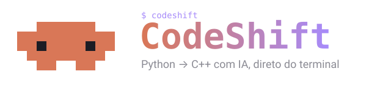

<p align="center">
  
</p>

<p align="center">
  Migre projetos <b>Python</b> para <b>C++</b> com um agente de IA, direto do terminal.
</p>

<p align="center">
  
  
  
  
  
</p>

<p align="center">
  
  
  
  
  
  
</p>

---

## Índice

- [O que é](#o-que-é)
- [Instalação](#instalação)
- [Início rápido](#início-rápido)
- [Configuração](#configuração)
- [Uso](#uso)
- [Como funciona](#como-funciona)
- [Estrutura](#estrutura)
- [Desenvolvimento](#desenvolvimento)

## O que é

O **CodeShift** percorre o seu projeto Python arquivo por arquivo e pede a um modelo de código que escreva a versão equivalente em C++. Tudo roda num menu de terminal, e o modelo pode ser local (LM Studio, Ollama ou qualquer servidor compatível com a API da OpenAI) ou carregado via `transformers`.

> ⚠️ **A migração substitui os arquivos `.py` pelos arquivos C++.** Faça um commit ou backup antes de rodar.

## Instalação

Requer **Python 3.10** ou mais novo.

```bash
pip install codeshift-ai
```

Para usar um modelo **local** pelo `transformers` (baixa o `torch`, então é pesado):

```bash
pip install "codeshift-ai[local]"
```

Confira se deu certo:

```bash
codeshift --version
```

> 💡 **Dica:** para instalar o comando de forma isolada, sem misturar com as bibliotecas do seu sistema, use o [pipx](https://pipx.pypa.io): `pipx install codeshift-ai`.

Para atualizar:

```bash
pip install --upgrade codeshift-ai
```

Depois de instalado, só o comando `codeshift` fica disponível. Não há API para importar.

## Início rápido

```bash
# 1. suba um servidor de modelo (exemplo com o LM Studio)
lms server start
lms load qwen2.5-coder-7b-instruct --context-length 16384 -y

# 2. entre na pasta do projeto Python que você quer migrar
cd meu-projeto

# 3. crie o .env apontando para o servidor
printf 'url = http://localhost:1234/v1\napi_key = lm-studio\n' > .env

# 4. abra o CodeShift, escolha "3 Configurar modelo" e depois "1 Migrar projeto"
codeshift
```

## Configuração

### 1. Servidor do modelo

O jeito mais simples é o [LM Studio](https://lmstudio.ai):

```bash
lms server start
lms load qwen2.5-coder-7b-instruct --context-length 16384 -y
```

Crie um `.env` na pasta do projeto que você quer migrar:

```env
url = http://localhost:1234/v1
api_key = lm-studio
```

| Variável | Para que serve |
|---|---|
| `url` | endereço do servidor compatível com a API da OpenAI |
| `api_key` | chave enviada ao servidor (no LM Studio pode ser qualquer texto) |

Sem a variável `url`, o CodeShift usa o modelo local via `transformers` (requer `pip install "codeshift-ai[local]"`).

### 2. Modelo e temperatura

Abra o `codeshift` e use a opção **Configurar modelo**. A escolha fica salva em `.codeshift/config.json`, dentro do projeto.

| Modelo | Observação |
|---|---|
| `Qwen/Qwen3-Coder-Next` | o mais capaz |
| `Qwen/Qwen2.5-Coder-14B-Instruct` | bom equilíbrio |
| `Qwen/Qwen2.5-Coder-7B-Instruct` | padrão para testar |
| `Qwen/Qwen2.5-Coder-3B-Instruct` | leve |

Temperaturas entre `0.2` e `0.3` costumam gerar JSON mais estável.

## Uso

Entre na pasta do projeto Python e rode:

```bash
cd meu-projeto
codeshift
```

```
╭────────────────────────────────────────────────────────╮
│  ██████        CodeShift v0.1.0                        │
│  ██████████    Migração de código para C++ com IA      │
│  ████  ████    Modelo   Qwen2.5-Coder-7B · temp 0.2    │
│    ████████    Servidor ● http://localhost:1234/v1     │
│      ██  ██    Pasta    ~/meu-projeto                  │
╰────────────────────────────────────────────────────────╯
```

| Opção | O que faz |
|---|---|
| **1** Migrar projeto para C++ | Roda o agente e substitui os `.py` por C++ |
| **2** Carregar modelo agora | Prepara o modelo antes de usar |
| **3** Configurar modelo | Escolhe modelo, temperatura e arquivo `.env` |
| **4** Atualizar configurações | Muda uma configuração já salva |
| **5** Ver árvore do projeto | Lista pastas e arquivos |
| **0** Sair | Fecha o programa |

| Comando | O que faz |
|---|---|
| `codeshift` | abre o menu |
| `codeshift --version` | mostra a versão instalada |

### Arquivos criados no seu projeto

| Caminho | Conteúdo |
|---|---|
| `.codeshift/config.json` | modelo, temperatura e arquivo `.env` escolhidos |
| `.codeshift/tree.json` | árvore do projeto com o status de cada arquivo |

Adicione `.codeshift/` ao `.gitignore` do projeto migrado.

## Como funciona

```
          ┌──────────────────────────────────────────────┐
          │              .codeshift/tree.json            │
          │  árvore binária: pastas, arquivos e status   │
          └───────────────┬──────────────────────────────┘
                          │ a cada turno
                          ▼
   ┌──────────┐    árvore + resultado    ┌──────────────┐
   │ CodeShift│ ───────────────────────▶ │    Modelo    │
   │  (loop)  │ ◀─────────────────────── │  (Qwen etc.) │
   └────┬─────┘     JSON com ações       └──────────────┘
        │ executa: read · save · update · update_status · quit
        ▼
   arquivos do projeto
```

1. O CodeShift monta uma **árvore binária** do projeto (`left` = primeiro filho, `right` = próximo irmão). Cada arquivo tem o status `pending` ou `visited`.
2. A cada turno o modelo recebe a lista de arquivos pendentes, a árvore e o resultado da rodada anterior.
3. Ele responde com **um JSON** de ações, executadas em ordem:

| Ação | `arg` | Efeito |
|---|---|---|
| `read` | `"caminho"` | devolve o texto do arquivo |
| `save` | `["caminho", "conteúdo"]` | cria um arquivo novo (ex.: um `.hpp`) |
| `update` | `["caminho", "novo_caminho", "novo_conteúdo"]` | troca o conteúdo e renomeia (`.py` → `.cpp`) |
| `update_status` | `["caminho", "visited"]` | marca o arquivo como tratado |
| `quit` | — | encerra |

4. O agente só termina quando não sobra nenhum `.py` pendente. O código recusa caminhos fora do projeto e pastas como `.git`, `.venv` e `.env*`.

O prompt completo do agente está em [`_codeshift/prompt/REFACTOR.md`](_codeshift/prompt/REFACTOR.md).

## Estrutura

```
CodeShift/
├── assets/logo.svg
├── pyproject.toml
└── _codeshift/
    ├── cli.py              # menu e telas do terminal
    ├── ui.py               # cores, caixas e componentes visuais
    ├── cmd.py              # roda comandos no terminal
    ├── schema.py           # modelos pydantic (config e ações)
    ├── agents/
    │   ├── refactor.py     # loop do agente
    │   ├── clean.py        # limpa cercas de markdown do JSON
    │   └── response/       # OpenAI-compatível e transformers
    ├── prompt/REFACTOR.md  # prompt do agente
    ├── settings/config.py  # configuração e .env
    └── utils/              # arquivos e árvore binária
```

## Desenvolvimento

Para mexer no código, clone o repositório e instale em modo editável (as mudanças valem na hora):

```bash
git clone https://github.com/BrayanDevZN/CodeShift.git
cd CodeShift
python -m venv .venv && source .venv/bin/activate
pip install -e ".[local]"
```
